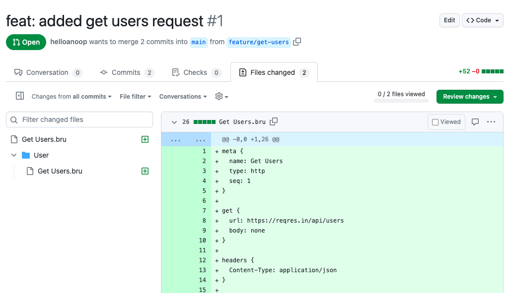

<br />


### 探云 API (TanyunAPI) - Opensource IDE for exploring and testing APIs.

[](https://github.com/CodeCoreLab/tanyun-api#readme)
[](https://github.com/CodeCoreLab/tanyun-api)

> 自研架构开发的开源桌面 API 客户端。

**English**
| [Українська](docs/readme/readme_ua.md)
| [Русский](docs/readme/readme_ru.md)
| [Türkçe](docs/readme/readme_tr.md)
| [Deutsch](docs/readme/readme_de.md)
| [Français](docs/readme/readme_fr.md)
| [Português (BR)](docs/readme/readme_pt_br.md)
| [한국어](docs/readme/readme_kr.md)
| [বাংলা](docs/readme/readme_bn.md)
| [Español](docs/readme/readme_es.md)
| [Italiano](docs/readme/readme_it.md)
| [Română](docs/readme/readme_ro.md)
| [Polski](docs/readme/readme_pl.md)
| [简体中文](docs/readme/readme_cn.md)
| [正體中文](docs/readme/readme_zhtw.md)
| [العربية](docs/readme/readme_ar.md)
| [日本語](docs/readme/readme_ja.md)
| [ქართული](docs/readme/readme_ka.md)
| [Nederlands](docs/readme/readme_nl.md)
| [فارسی](docs/readme/readme_fa.md)
| [हिन्दी](docs/readme/readme_hi.md)

探云 API（TanyunAPI）是自研架构的开源桌面 API 客户端，面向 HTTP / gRPC / GraphQL / WebSocket 联调与集合回归。

探云 API 将接口集合直接保存在本地文件系统目录中，以普通文本文件描述 API 请求。

可用 Git 或任意版本控制协作管理接口集合。

探云 API 离线优先，不强制云同步；数据默认留在本机。

仓库：[CodeCoreLab/tanyun-api](https://github.com/CodeCoreLab/tanyun-api)


 <br /><br />

## Table of Contents

- [Installation](#installation)
- [CLI](#cli)
- [Run with Docker](#run-with-docker)
- [Features](#features)
  - [Run across multiple platforms 🖥️](#run-across-multiple-platforms-%EF%B8%8F)
  - [Collaborate via Git 👩‍💻🧑‍💻](#collaborate-via-git-%E2%80%8D%E2%80%8D)
- [Important Links 📌](#important-links-)
- [Showcase 🎥](#showcase-)
- [Share Testimonials 📣](#share-testimonials-)
- [Publishing to New Package Managers](#publishing-to-new-package-managers)
- [Stay in touch 🌐](#stay-in-touch-)
- [Trademark](#trademark)
- [Contribute 👩‍💻🧑‍💻](#contribute-%E2%80%8D%E2%80%8D)
- [Authors](#authors)
- [License 📄](#license-)

## Installation

探云 API 可通过本仓库 Releases 获取桌面端构建产物（Mac / Windows / Linux），具体安装步骤见发布说明。

```sh
# 克隆源码本地开发
git clone https://github.com/CodeCoreLab/tanyun-api.git
cd tanyun-api
npm install
npm run dev
```

## CLI

The **CLI** lets you run your API collections from the command line, which is ideal for automated testing and CI/CD pipelines. Install it from npm using the package manager of your choice:

```sh
npm install -g @tanyun/cli
```

Navigate to the directory containing your collection and run it:

```sh
# Run every request in the collection
bru run

# Run a single request
bru run request.yml

# Run a folder against a specific environment
bru run folder --env Local
```

For the full command reference, see the CLI help (`tanyun --help`) and repository docs.

## Run with Docker

Official Docker images for the **CLI** let you run API collections in CI/CD pipelines and locally without installing Node.js or npm on the host. Build from `Dockerfile` in this repository; `alpine` and `debian` variants support `linux/amd64` and `linux/arm64`.

```sh
# 本地构建 CLI 镜像
docker build -f packages/bruno-cli/docker/images/alpine/Dockerfile -t tanyun-cli .

# 挂载当前目录运行集合
docker run -v "$(pwd):/collections" tanyun-cli run collections/
```

For Docker image build and CI examples, see `Dockerfile` and `.github/workflows` in this repository.

## Features

### Run across multiple platforms 🖥️

 <br /><br />

### Collaborate via Git 👩‍💻🧑‍💻

Or any version control system of your choice

 <br /><br />

## Important Links 📌

- [Repository](https://github.com/CodeCoreLab/tanyun-api)
- [Releases](https://github.com/CodeCoreLab/tanyun-api/releases)

## Showcase 🎥


## Share Testimonials 📣

If TanyunAPI has helped you at work and your teams, please share feedback via [GitHub Issues](https://github.com/CodeCoreLab/tanyun-api/issues).

## Publishing to New Package Managers

Please see [here](publishing.md) for more information.

## Stay in touch 🌐


[Repository](https://github.com/CodeCoreLab/tanyun-api) <br />
[Repository](https://github.com/CodeCoreLab/tanyun-api) <br />
[Issues](https://github.com/CodeCoreLab/tanyun-api/issues)

## Trademark

**Name**

`TanyunAPI` is a project mark of [CodeCoreLab](https://github.com/CodeCoreLab/tanyun-api)

**Logo**

The logo is sourced from [OpenMoji](https://openmoji.org/library/emoji-1F436/). License: CC [BY-SA 4.0](https://creativecommons.org/licenses/by-sa/4.0/)

## Contribute 👩‍💻🧑‍💻

I am happy that you are looking to improve TanyunAPI. Please check out the [contributing guide](contributing.md)

Even if you are not able to make contributions via code, please don't hesitate to file bugs and feature requests that needs to be implemented to solve your use case.

## Authors

<div align="center">
    <a href="https://github.com/CodeCoreLab/tanyun-api/graphs/contributors">
        
    </a>
</div>

## License 📄

[MIT](license.md)
